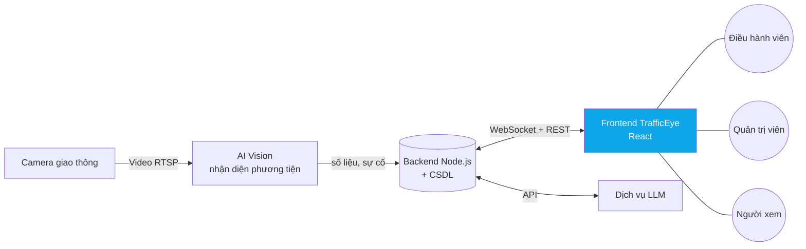
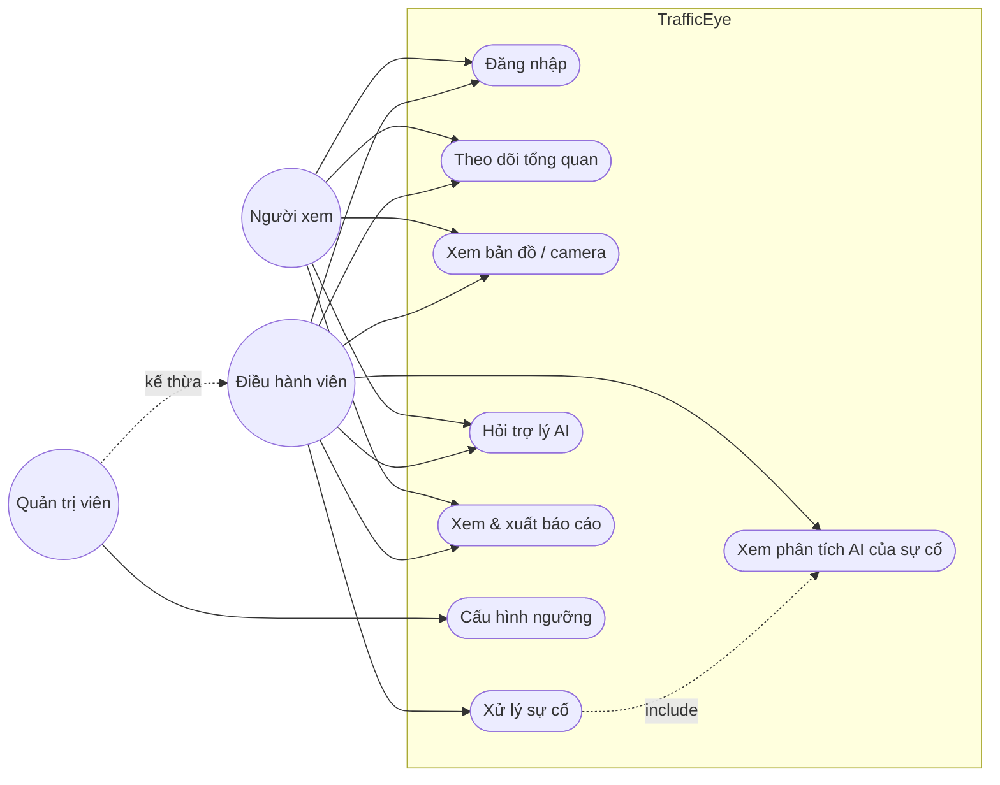
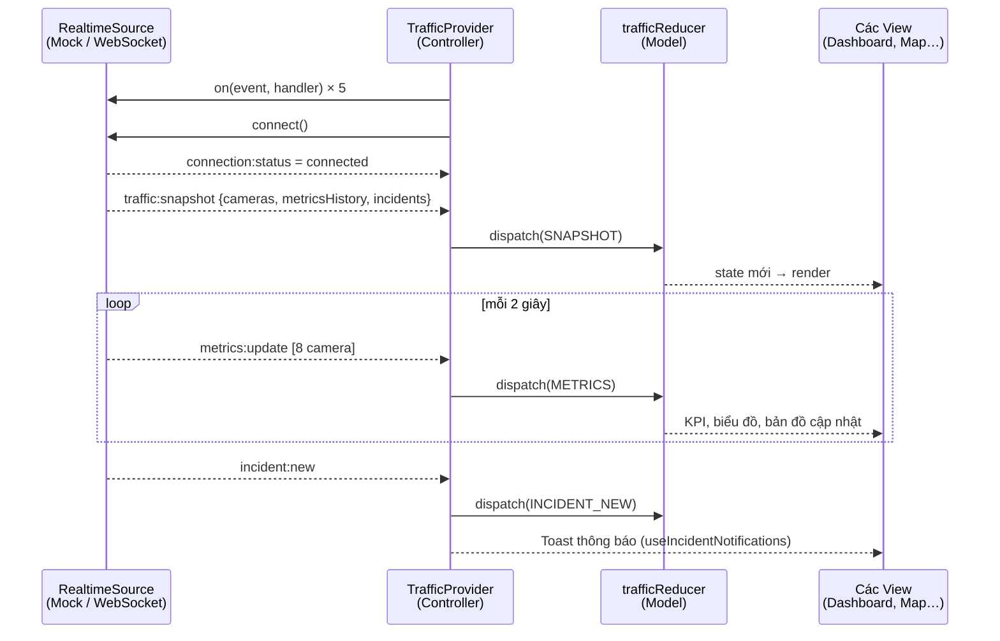
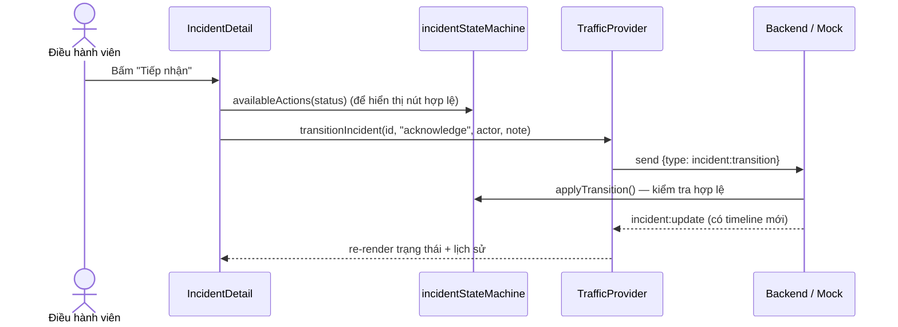
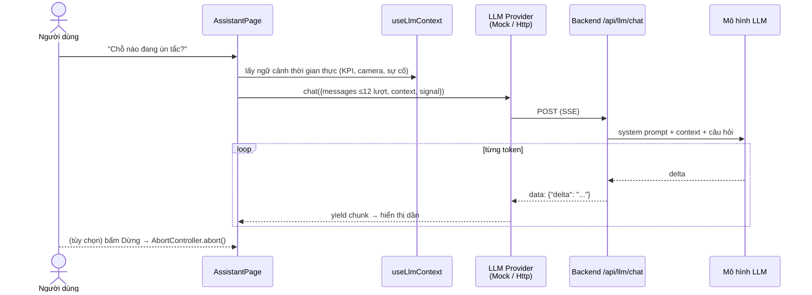
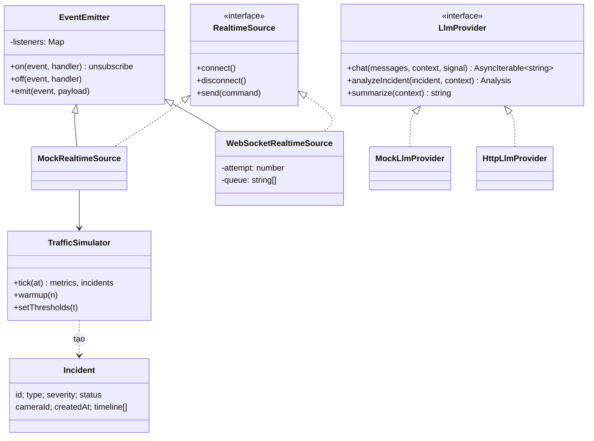
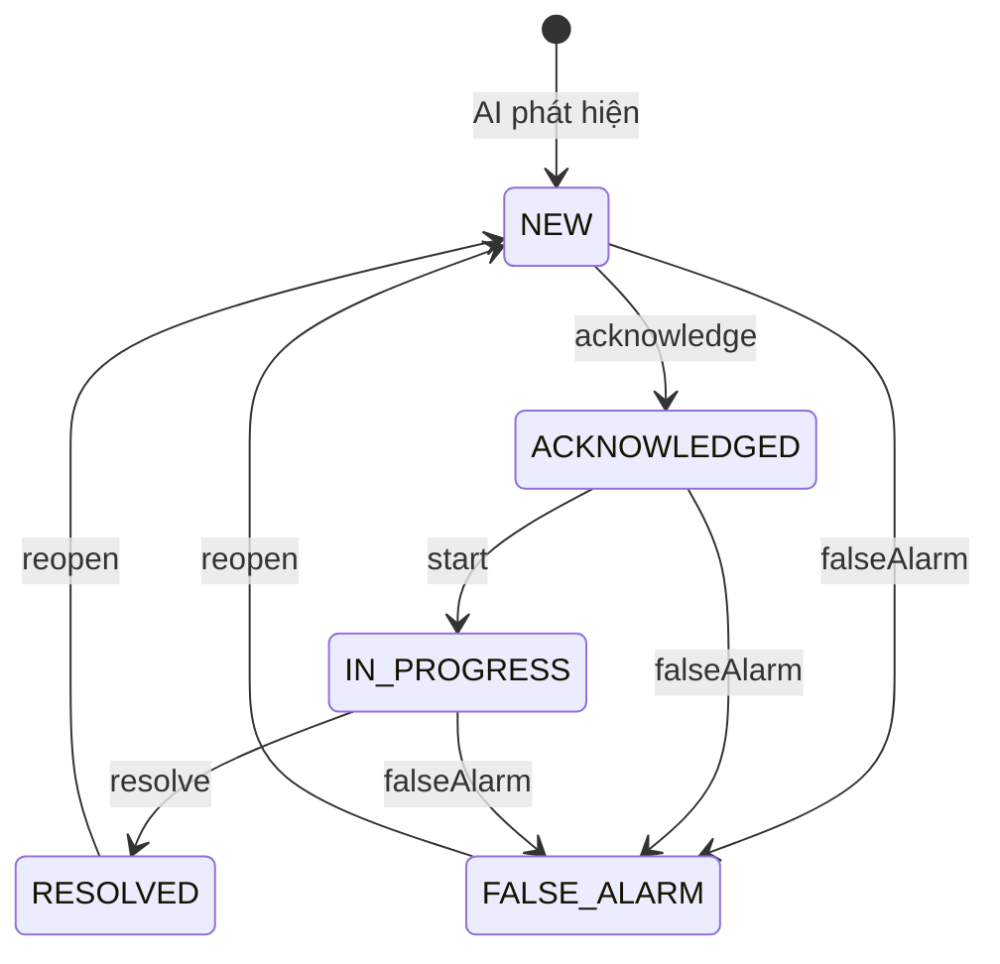

# 02 · Mô hình hóa hệ thống

> Áp dụng **Chương 5 – Mô hình hóa hệ thống**: mô hình ngữ cảnh, tương tác (use case, sequence), cấu trúc (class) và hành vi (state). Sơ đồ viết bằng Mermaid — xem trực tiếp trên GitHub/VS Code.

## 1. Mô hình ngữ cảnh (Context model)

Phạm vi giai đoạn này: **Frontend** (khối tô màu). Backend, AI Vision và LLM được thay bằng **bộ giả lập** có cùng giao diện để phát triển song song.

## 2. Use case

## 3. Sequence – luồng dữ liệu thời gian thực (Observer)

## 4. Sequence – xử lý sự cố

Backend là **nguồn sự thật**: frontend gửi lệnh, chỉ cập nhật khi nhận sự kiện `incident:update` → mọi điều hành viên thấy cùng một trạng thái.

## 5. Sequence – hỏi trợ lý AI (streaming)

## 6. Class diagram (tầng frontend)

## 7. State diagram – vòng đời Sự cố

Cài đặt chính xác sơ đồ này tại `frontend/src/domain/incidentStateMachine.js`, kiểm thử tại `domain/__tests__/domain.test.js`.
