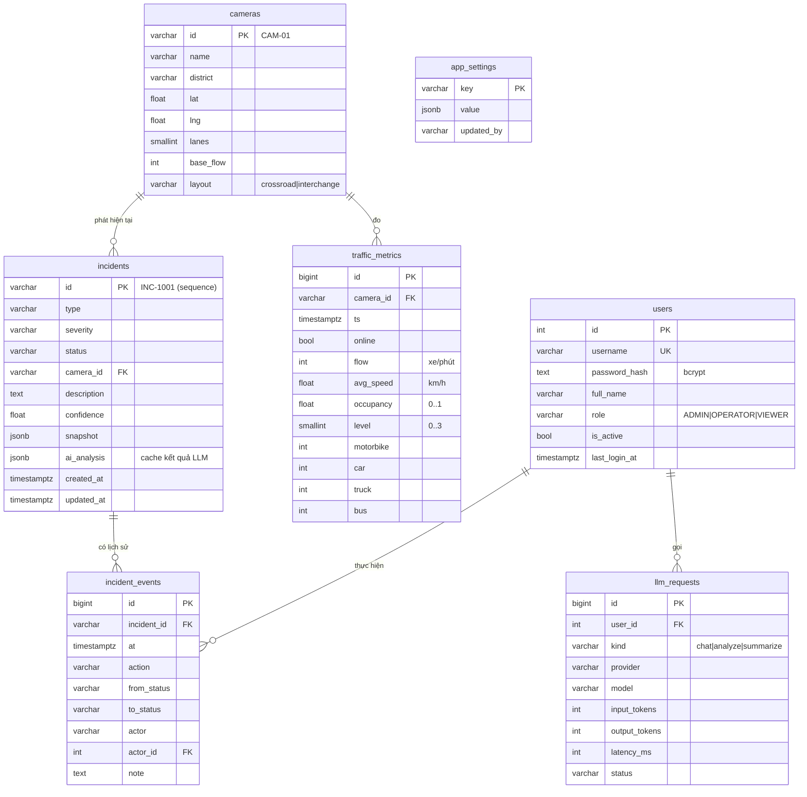

# 07 · Thiết kế cơ sở dữ liệu (PostgreSQL 17)

> Lược đồ được quản lý phiên bản bằng **Alembic** (`backend/alembic/versions`). Không sửa CSDL bằng tay.

## 1. Sơ đồ thực thể – quan hệ (ERD)



## 2. Ràng buộc toàn vẹn

| Bảng | Ràng buộc | Mục đích |
|---|---|---|
| users | `UNIQUE(username)`, `CHECK role IN (...)` | Không trùng tài khoản, vai trò hợp lệ |
| cameras | `CHECK layout IN ('crossroad','interchange')` | Loại nút giao hợp lệ |
| traffic_metrics | `CHECK level BETWEEN 0 AND 3`, `occupancy BETWEEN 0 AND 1`, `flow, avg_speed >= 0` | Số liệu hợp lệ dù ghi từ nguồn nào |
| incidents | `CHECK` cho type/severity/status/confidence, FK → cameras | Trạng thái sự cố luôn thuộc máy trạng thái |
| incident_events | FK → incidents `ON DELETE CASCADE`, FK → users `ON DELETE SET NULL` | Giữ lịch sử kể cả khi xóa tài khoản |

## 3. Chỉ mục (index) theo truy vấn thực tế

| Index | Truy vấn phục vụ |
|---|---|
| `ix_metrics_camera_ts (camera_id, ts DESC)` | Số liệu gần nhất của 1 camera, lịch sử theo camera |
| `ix_metrics_ts (ts)` | Gộp theo phút/giờ cho biểu đồ & báo cáo, dọn dữ liệu cũ |
| `ix_incidents_status`, `ix_incidents_created_at DESC` | Danh sách sự cố đang mở, mới nhất trước |
| `ix_incident_events_incident (incident_id, at)` | Dòng thời gian xử lý của sự cố |
| `ix_llm_requests_created_at` | Thống kê chi phí LLM theo thời gian |

## 4. Khối lượng dữ liệu & lưu trữ

- 8 camera × 1 bản ghi / 2 giây ≈ **345.600 dòng/ngày** ở `traffic_metrics`.
- Tác vụ nền xóa số liệu chi tiết cũ hơn `METRICS_RETENTION_DAYS` (mặc định 7 ngày) mỗi giờ.
- Hướng mở rộng (BE-18): chuyển `traffic_metrics` thành hypertable **TimescaleDB** + continuous aggregate theo giờ/ngày để lưu dài hạn.

## 5. Vận hành

```bash
docker compose up -d db                 # PostgreSQL 17
cd backend
alembic upgrade head                    # tạo/cập nhật lược đồ
python -m app.db.seed                   # tài khoản demo, camera, ngưỡng (chạy lặp lại an toàn)
alembic revision --autogenerate -m "…"  # khi đổi model – NHỚ rà lại file sinh ra
docker compose --profile tools up -d    # Adminer xem CSDL tại http://localhost:8080
```
