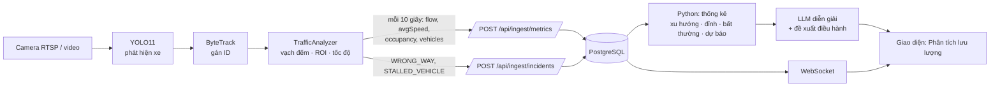

# 08 · Trích xuất lưu lượng bằng AI Vision và phân tích bằng LLM

## 1. Chọn mô hình

| Bước | Mô hình / kỹ thuật | Lý do chọn |
|---|---|---|
| Phát hiện phương tiện | **YOLO11** (Ultralytics) – `yolo11n` (nhanh, chạy CPU) hoặc `yolo11s` (chính xác hơn, nên có GPU) | Thời gian thực, có sẵn lớp `motorcycle`, `car`, `bus`, `truck` (COCO), dễ tinh chỉnh |
| Bám vết | **ByteTrack** (tích hợp sẵn trong Ultralytics) | Gán ID ổn định qua các khung hình → mỗi xe chỉ đếm **một lần**; giữ được xe bị che khuất ngắn |
| Trích xuất chỉ số | Hình học: vạch đếm ảo, vùng làn (ROI), hiệu chỉnh mét/pixel | Đơn giản, giải thích được, kiểm thử được bằng dữ liệu tổng hợp |
| Diễn giải | **LLM** (`claude-opus-5-5`, có bộ dự phòng theo luật) | Chỉ nhận **số liệu đã tổng hợp**, không nhận hình ảnh |

**Lưu ý:**
- Mô hình COCO gốc nhận xe máy khá tốt nhưng giảm độ chính xác khi xe máy rất dày, che khuất nhau (đặc thù Việt Nam). Nên **tinh chỉnh** bằng ảnh camera giao thông trong nước (gán nhãn vài nghìn khung hình), rồi chạy worker với `--weights best.pt`.
- Giấy phép: Ultralytics là **AGPL-3.0** (phù hợp đồ án/nghiên cứu). Nếu thương mại hóa, cân nhắc mô hình giấy phép Apache-2.0 (RT-DETR, YOLOX) – chỉ cần thay `detector.py`.
- **Vì sao không gửi khung hình cho LLM đa phương thức?** Chi phí và độ trễ cao khi gọi liên tục, đếm số lượng lớn kém chính xác, và lộ hình ảnh cá nhân/biển số. Mô hình chuyên dụng đếm tốt hơn, rẻ hơn; LLM làm phần nó giỏi: **diễn giải và đề xuất**.

## 2. Luồng xử lý



**Chia việc rõ ràng để tránh LLM "bịa số":** mô hình thị giác *đếm*, Python *tính thống kê* (tất định, có test), LLM *diễn giải* đúng các con số được đưa vào (structured outputs).

## 3. Công thức chỉ số (`vision/trafficeye_vision/analytics.py`)

| Chỉ số | Cách tính |
|---|---|
| Lưu lượng (xe/phút) | Số ID cắt qua vạch đếm trong cửa sổ × 60 / độ dài cửa sổ |
| Cơ cấu phương tiện | Như trên, tách theo loại (lớp được chọn theo đa số phiếu qua các khung hình) |
| Tốc độ TB (km/h) | Trung vị vận tốc các xe trong vùng làn mỗi khung (dịch chuyển điểm chạm đất ~1–2 s × mét/pixel × 3.6), lấy trung bình theo cửa sổ. Xe đứng yên = 0 km/h; vùng làn trống → tốc độ dòng tự do |
| Chiếm dụng (0–1) | Tỉ lệ điểm lưới mẫu trong vùng làn nằm trong khung xe, trung bình theo thời gian |
| Mức ùn tắc | **Backend** tính theo ngưỡng do Quản trị viên cấu hình (không tính ở worker) |
| Đi ngược chiều | Hướng di chuyển khi cắt vạch ngược với `direction` hiệu chỉnh |
| Xe dừng bất thường | Tốc độ < 1.5 km/h trong vùng làn liên tục quá `stalledSeconds` |

## 4. Chạy worker

Môi trường đã cài trên máy phát triển: `C:\Users\HELLO\.venvs\trafficeye-vision` (torch 2.15 CPU, Ultralytics 8.4, OpenCV 5). Cài mới:

```bash
python -m venv <venv>
<venv>\Scripts\pip install torch torchvision --index-url https://download.pytorch.org/whl/cpu
<venv>\Scripts\pip install -r vision/requirements.txt
```

Chạy trong thư mục `vision/` (lần đầu tự tải `yolo11n.pt` ~5.6 MB):

```bash
set VP=C:\Users\HELLO\.venvs\trafficeye-vision\Scripts\python
%VP% -m trafficeye_vision.worker --source samples/street-person-bicycle-car.mp4 --camera CAM-05 --loop --realtime
%VP% -m trafficeye_vision.worker --source rtsp://user:pass@ip/stream --camera CAM-01 --calib calibration/CAM-01.json
%VP% -m trafficeye_vision.worker --source video.mp4 --camera CAM-02 --dry-run --save ketqua.mp4
```

Worker gửi: số liệu mỗi 10 giây (`/api/ingest/metrics`), sự cố (`/api/ingest/incidents`) và **ảnh đã vẽ khung nhận diện ~1 ảnh/giây** (`/api/ingest/frames/{camera}`). Trên giao diện (chế độ `websocket`), camera đó tự chuyển từ khung mô phỏng sang **hình trực tiếp** có nhãn "TRỰC TIẾP · YOLO11 + ByteTrack". Ảnh chỉ giữ bản mới nhất trong bộ nhớ backend, không lưu CSDL và **không gửi cho LLM**.

Khi worker gửi dữ liệu cho một camera, **bộ giả lập tự nhường** camera đó (30 giây không có dữ liệu thật thì giả lập chạy lại).

**Kết quả chạy thử** (video mẫu bãi đỗ xe 768×432, CPU): ~12–16 khung hình/giây, ô tô nhận diện với độ tin cậy ~0.88, ID ByteTrack ổn định, đếm đúng xe cắt vạch; người đi bộ/xe đạp không bị đếm. Hạn chế: góc quay từ trên cao đôi khi nhầm ô tô ↔ xe tải; `metersPerPixel` mặc định chưa hiệu chỉnh nên tốc độ chỉ mang tính tương đối → cần file hiệu chỉnh cho từng camera và nên tinh chỉnh mô hình bằng video giao thông Việt Nam.

## 5. Phân tích bằng LLM

- API: `POST /api/llm/analyze-traffic { cameraId?, minutes }` → `{ summary, trend, peaks[], anomalies[], forecast, recommendations[], stats, series, dataSource, model }`.
- Giao diện: cửa sổ chi tiết camera → **Phân tích lưu lượng** (chọn 15 phút / 1 giờ / 3 giờ).
- Thống kê đầu vào: lưu lượng & tốc độ trung bình, xu hướng (so sánh 1/3 đầu và 1/3 cuối, ngưỡng ±10%), đỉnh/đáy, bất thường (lệch quá 2 độ lệch chuẩn), số phút ùn ứ, dự báo 15 phút (hồi quy tuyến tính 10 điểm gần nhất).

## 6. Đánh giá độ chính xác (kế hoạch)

1. Chọn 3–5 đoạn video 5 phút ở các khung giờ khác nhau (sáng, trưa, cao điểm, mưa/đêm).
2. Đếm tay số xe qua vạch theo từng loại → so với worker: sai số tuyệt đối trung bình theo phần trăm (MAPE) mục tiêu < 10% cho tổng lưu lượng.
3. Đo tốc độ bằng 2 mốc đã biết khoảng cách trên mặt đường → hiệu chỉnh `metersPerPixel`.
4. Theo dõi tốc độ xử lý (khung hình/giây) trên máy triển khai, chọn `yolo11n`/`yolo11s` và `--stride` phù hợp.

## 7. Kiểm thử

- `vision/tests/test_analytics.py` (7 test): đếm mỗi xe một lần theo loại, tốc độ từ dịch chuyển pixel, đường trống không bị coi là ùn tắc, phát hiện ngược chiều, xe dừng bất thường, chiếm dụng tăng theo hàng chờ.
- Backend: `tests/unit/test_traffic_analysis.py` (5 test), integration `TestTrafficAnalysis` (gửi số liệu như worker → phân tích).
